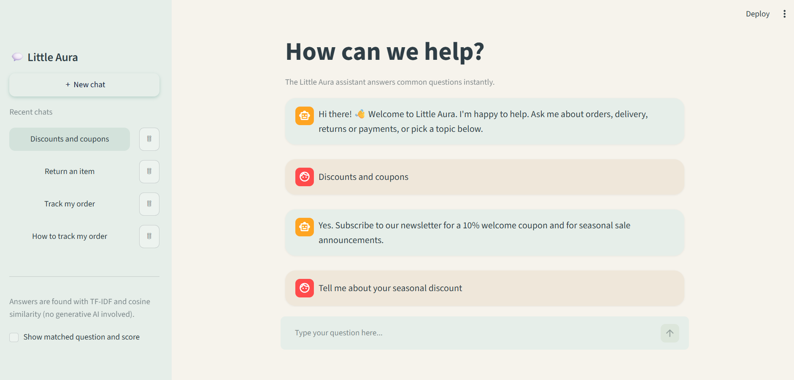

# CodeAlpha_FAQChatbot

A FAQ chatbot for a demo online store called **Little Aura**, built with Python,
NLTK, scikit-learn and Streamlit. Created for the CodeAlpha Artificial Intelligence
internship (Task 2).

## Features
- Answers customer questions by finding the most similar FAQ (about 45 FAQs)
- Text preprocessing with NLTK: lowercasing, punctuation removal, tokenizing,
  stop-word removal and stemming
- TF-IDF vectors and cosine similarity for matching
- Several paraphrases per FAQ to handle different wordings
- A similarity threshold, so the bot says "I don't know" instead of guessing
- Streamlit chat interface: quick-reply buttons, typing pause, calm color theme,
  and a saved chat history sidebar (new chat, switch, delete)

## How it works
1. FAQs are stored in `faqs.json` (a question, extra phrasings, and an answer).
2. Every phrasing is preprocessed and converted to a TF-IDF vector.
3. The customer's question goes through the same steps.
4. Cosine similarity finds the closest FAQ phrasing.
5. If the score is above the threshold (0.25), the bot shows that FAQ's answer;
   otherwise it admits it doesn't know.

## Installation
```
git clone https://github.com/SeheleeHossain79/CodeAlpha_FAQChatbot.git
cd CodeAlpha_FAQChatbot
python -m venv venv
venv\Scripts\activate
python -m pip install -r requirements.txt
python setup_nltk.py
python -m streamlit run app.py
```

## Testing and results
Three test files check whether each question reaches the correct FAQ
(`python test_accuracy.py`, `python new_test.py`, `python new_test2.py`).

| Round | Questions | Result | What happened |
|---|---|---|---|
| 1. First test (before fixes) | 20 | 65% | Found a negation bug, no stemming, missing paraphrases |
| 2. After fixes | 20 | 90% to 100% | Switched to stemming, fixed the bug, added variants |
| 3. Fresh questions (before adding FAQs) | 10 | [your first score from test_new] | Most failures were FAQs that did not exist yet |
| 4. 25 + 25 new questions | 50 | 100% after tuning | Added about 28 FAQs and phrasings |

**Honest note:** the later rounds reached 100% after I tuned the FAQs on those
same questions, so that number shows coverage of my test questions, not accuracy on
completely unseen ones. The first-round scores are the better guide to real
performance. Failures were mostly missing content, or two similar FAQs competing.

## Tech stack
Python, NLTK, scikit-learn, Streamlit

## Limitations
- Matching is based on shared words, not meaning, so a question with no words in
  common with any FAQ can be missed. Adding paraphrases helps.
- Similar FAQs (for example discounts and promo codes) can compete with each other.
- Chat history is stored in one local file (`chats.json`), so it is not per-user.
- Possible upgrades: sentence embeddings (sentence-transformers) to match on meaning,
  a database with user logins, and an admin page for editing FAQs.

## Screenshot
